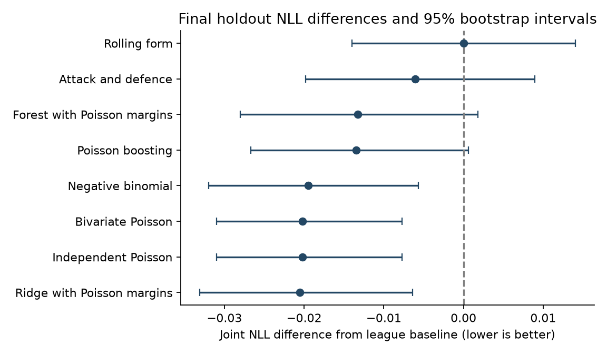

# National Hockey League Goal Prediction

**Howard R. Silvey · Research edition 0.1.0 · October 2, 2026**

A 2026 revision and extension of *National Hockey League Data: Analysis and
Prediction*, the 2020 Carleton University honours project supervised by
Dr. Jason Nielsen. The original submission is preserved separately and unchanged.

## Read the research

The PDF is the primary sharing and display document. Each has an editable Word
companion generated from the same document source.

| Document | Primary PDF | Editable DOCX |
| --- | --- | --- |
| Thesis revision with empirical results | [Thesis](outputs/NHL-Goal-Prediction-2026-Thesis-Revision.pdf) | [Word](outputs/NHL-Goal-Prediction-2026-Thesis-Revision.docx) |
| Archival audit and reproduction status | [Audit](outputs/NHL-2020-Archival-Audit-and-Reproduction-Status.pdf) | [Word](outputs/NHL-2020-Archival-Audit-and-Reproduction-Status.docx) |
| Research protocol and reproducibility | [Protocol](outputs/NHL-2026-Research-Protocol-and-Reproducibility.pdf) | [Word](outputs/NHL-2026-Research-Protocol-and-Reproducibility.docx) |
| Original 2020 submission | [Archival PDF](archive/Silvey-2020-NHL-Honours-Project.pdf) | Original editable source not recovered |

## What this edition establishes

The first empirical experiment compares **nine variants on 10,969 regular-season
games** from 2016-17 through 2024-25. Five temporally ordered development seasons
contain 5,885 games; the frozen final holdout contains 1,312 games from 2024-25.
The 2016-17 through 2018-19 foundation contains 3,772 games.

The development-selected bivariate-Poisson label is numerically tied with
independent Poisson, and its fitted shared component is **zero**. These variants
therefore make identical forecasts. The tie selected the bivariate label through
the implementation's deterministic ordering; it is not evidence for dependence.

| Final holdout quantity | League baseline | Frozen count model |
| --- | ---: | ---: |
| Mean joint negative log likelihood | 3.87545 | 3.85526 |
| Combined MAE per team-game | 1.39229 | 1.38806 |
| Combined RMSE per team-game | 1.73687 | 1.72034 |
| Regulation-outcome Brier score | 0.63919 | 0.62735 |

The paired calendar-week bootstrap NLL difference is -0.02019, with a 95%
percentile interval [-0.03101, -0.00774]. This is a **modest probabilistic gain
and a very small point-error gain**. A ridge predictor embedded in Poisson margins
has the smallest numerical holdout NLL (3.85493); it does not replace the frozen
family after test-season inspection. Tree-model comparison intervals cross zero.



## Scientific boundaries

- Original 2020 headline results are visually source-verified, **not computationally reproduced**.
- Regulation scores are reconstructed from MoneyPuck actual goals and elapsed time;
  all 54 stratified official-score checks agree. One incomplete record is excluded.
- Features exclude current and same-date outcomes. Historical publication times and
  source revisions are **not** verified; this is a retrospective calendar-date study.
- Raw data and row-level derivatives are excluded from this repository. Credit
  **MoneyPuck.com** for the empirical data and respect its non-commercial-use terms.
- Bayesian hierarchical, dynamic state-space, xG, roster, goalie, neural and
  betting-return models are not claimed as completed.
- Version 0.1.0 is an initial empirical research release. Full academic review and
  the remaining research programme are pending; it is not a replacement university submission.

## Quick verification

Python 3.12 is required. Create an isolated environment and install the pinned
dependencies. No network or third-party game data are needed for the invariant tests.

```sh
python -m venv .venv
# Windows: .venv\Scripts\activate
# macOS/Linux: source .venv/bin/activate
python -m pip install -r requirements.lock
python -m unittest discover -s tests -v
python scripts/verify_release.py
```

## Reproduce the frozen empirical study

MoneyPuck provides the input through its explicitly listed download, subject to
its terms: <https://moneypuck.com/data.htm>. This is non-commercial research.

```sh
python scripts/acquire.py --accept-noncommercial-terms
python scripts/reproduce_frozen.py
```

**The source hash must match the release snapshot.** The current download can
change. A changed snapshot must become a separately versioned experiment, not
an unreported overwrite of the released study. The original raw snapshot is retained
locally and not redistributed; full empirical reproducibility depends on source access.

The original one-time selection runner is `scripts/run_study.py --holdout`.
It refuses to overwrite a frozen study. Replay uses existing configurations and
does not search hyperparameters. Historical run details are in `reports/tuning-ledger.json`.

`scripts/development_sensitivity.py` implements separately labeled exploratory
5/10/40-game and feature-ablation checks on development seasons only. They were
specified after the first evaluation and do not retune or rescore the final holdout.
The 40-game variant performs best in those development follow-ups, without being
promoted to the current release's primary model.

After a replay, feature generation for the R check can be performed with the
data functions or retained local `data/processed/features.csv`:

```sh
Rscript scripts/r_poisson_parity.R .
```

The base-R Poisson model matches Python NLL/MAE within 3e-9 in the verified run.
This is targeted parity, not an all-model R implementation.

## Build the documents

```sh
python scripts/build_figures.py
python scripts/build_documents.py
```

On Windows with Microsoft Word, export the same DOCX files to PDF:

```powershell
./scripts/export_documents.ps1
```

On other platforms, a compatible DOCX-to-PDF renderer is needed. Rendering,
pagination, fonts and accessibility can differ by platform. The committed PDFs
are the primary reviewed layout; all pages were rendered for visual inspection.

## Repository map

- `archive/`: unchanged 2020 PDF and archival checksum manifest.
- `docs/`: frozen protocol, governance, source audit, data/model cards and roadmap.
- `src/nhl_forecast/`: canonical data, date-safe features, models and proper scoring.
- `scripts/`: acquisition, validation, one-time study, frozen replay, R parity and documents.
- `tests/`: synthetic invariants that expose leakage and distribution errors.
- `reports/`: source manifest, aggregate results, checks and generated figures.
- `outputs/`: thesis, audit and protocol in PDF and DOCX.

See [data availability](DATA_AVAILABILITY.md), [status](docs/STATUS.md),
[decisions](DECISIONS.md), [limitations](docs/MODEL_CARD.md) and
[release notes](docs/RELEASE_NOTES.md). Original source recovery is tracked separately.

## Citation and rights

Use `CITATION.cff` for this research edition; cite the 2020 archival project
separately. Original software is MIT licensed. Manuscripts and archival documents
remain copyright Howard R. Silvey. Third-party data retain their own rights and
terms. This repository is not affiliated with or endorsed by the NHL, MoneyPuck
or Carleton University.
